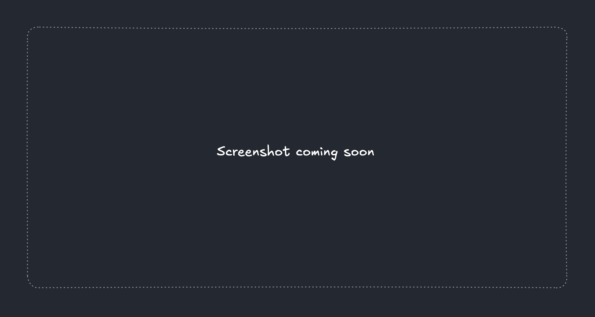

<h1 align="center">Headbase</h1>

<strong>Headbase</strong> is an experimental personal productivity app. Create content databases and query with views like a list, table, kanban board, calendar, canvas and graph.

  <a href="/docs/install">Install</a> •
  <a href="/docs/user-guide">User Guide</a> •
  <a href="/docs/developer">Developer Docs</a> •
  <a href="https://github.com/headbase-app/headbase/issues">Feedback</a> •
  <a href="https://github.com/headbase-app/headbase/issues">Report Issue</a>

## About
> [!WARNING]
> This is an experimental project, no packages/APIs/apps are considered stable and may dramatically change.
> You're welcome to explore at your own risk, but expect bugs, missing docs, incomplete features etc!

Headbase is an exploration of [local-first software](https://www.inkandswitch.com/essay/local-first) and [malleable systems](https://malleable.systems). The goal isn't to create a "notes app" or a "task management" app, but to develop foundations for users to build their own experience while retaining control and agency over their own data.

**SUPPORTED PLATFORMS**: Linux (Ubuntu), MacOS and Android. Windows and iOS support is planned, but not a current priority early in development.

**For users:**
- [Install](docs/user-guide/install.md)
- [Getting started](docs/user-guide/getting-started.md)
- [User guide](docs/user-guide/README.md)
- [FAQs](docs/user-guide/faqs.md)
- [Feedback](https://github.com/headbase-app/headbase/issues)
- [Report issue](https://github.com/headbase-app/headbase/issues)

**For nerds:**
- [Architecture](docs/developer/architecture/README.md)
- [Build a plugin](docs/developer/plugins/README.md)
- [Local development](docs/developer/setup/README.md)

### Features

#### Vaults
#### Content Types / Schemas
#### Views and Data Sources
#### Workspaces

## Contributions
This project is currently open source, not open contribution.
You're welcome to try it out, ask questions, raise bug reports etc but it wouldn't be practical to accept external code contributions or feature requests yet.

I'm open to this changing in the future once the project is more stable, collaboration is one of the great things about open source after all!

## Credits
Inspired by great tools such as [Obsidian](https://obsidian.md/), [Notion](https://www.notion.com/) and [Todoist](https://www.todoist.com/).

## License
Headbase is released under the [GNU AGPLv3](https://choosealicense.com/licenses/agpl-3.0/) licence.
